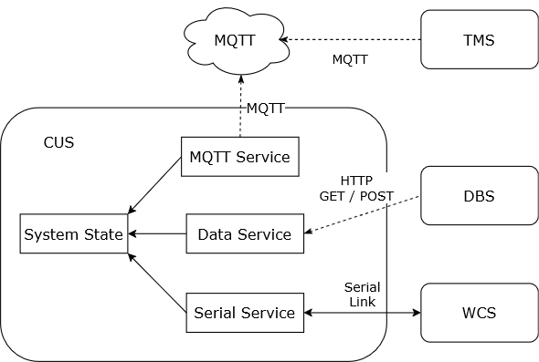
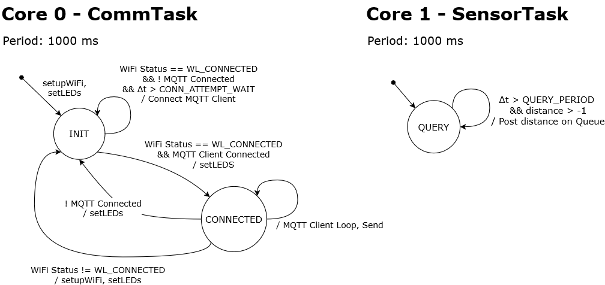
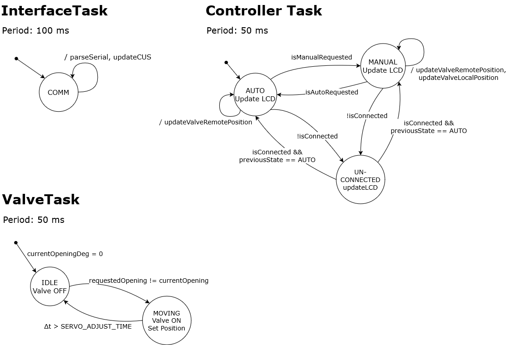
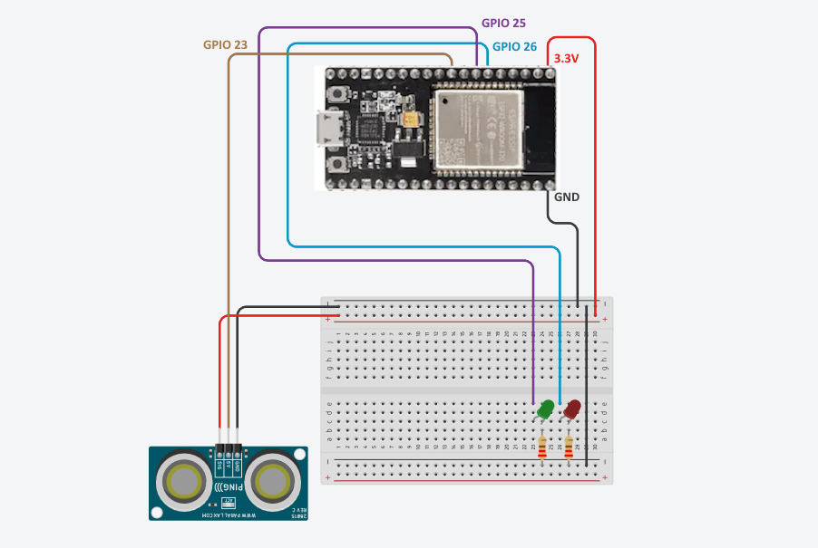
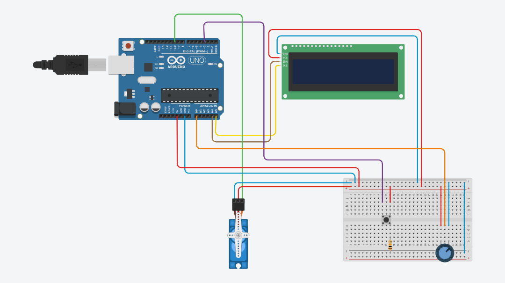

# Smart Tank Monitoring System

Built for the Embedded Systems and IoT course at the University of Bologna (a.y. 2025/2026).
Full specification: [assignment-03.md](https://github.com/pslab-unibo/esiot-2025-2026/blob/master/assignments/assignment-03.md).

Distributed IoT system that monitors the rainwater level of a tank and drives the valve draining it into a water channel network. An **ESP32** running **FreeRTOS** samples the water level and publishes it over **MQTT**, an **Arduino Uno** controls the valve and a local operator panel, a **Java/Vert.x backend** coordinates the whole system and applies the control policy, and a **web dashboard** lets remote operators monitor and take command.


## Overview

The system runs in `AUTOMATIC` or `MANUAL` mode. In `AUTOMATIC` mode the backend operates the valve according to the default control policy (opens the valve to 50% when the level stays above L1 for more than T1, and to 100% as soon as it exceeds L2). In `MANUAL` mode an operator sets the opening, either on site (button and potentiometer on the Arduino) or remotely from the dashboard. If no measurement arrives from the ESP32 for longer than a time threshold T2, the system goes `UNCONNECTED` and recovers on its own once data flows again.



| Subsystem | Platform | Role |
|---|---|---|
| TMS (Tank Monitoring) | ESP32, FreeRTOS | Samples the water level with a sonar, shows network status through LEDs |
| WCS (Water Channel) | Arduino Uno | Drives the servo valve, provides local operator panel |
| CUS (Control Unit) | Java, Vert.x | Control policy, connectivity watchdog, REST API |
| DBS (Dashboard) | HTML/JS, Chart.js | Level chart, system state, mode and valve controls |

## Architecture

The same design idea is used across all subsystems: independent periodic tasks, each implemented as a **synchronous finite state machine**, exchanging data through a shared state object (blackboard) instead of calling each other directly.

**TMS (ESP32):** Two FreeRTOS tasks pinned to separate cores. `SensorTask` reads the HC-SR04 sonar every second and writes the value to a single slot queue with `xQueueOverwrite`, so the consumer always sees the latest reading. `CommTask` handles WiFi and MQTT reconnection, publishes the reading and switches the status LEDs on network failure.

**WCS (Arduino):** A cooperative scheduler with a 50 ms base tick runs three tasks over a shared `Context`. `InterfaceTask` parses commands from the CUS and sends back a heartbeat message with the local state, `ControllerTask` handles the `AUTO`/`MANUAL`/`UNCONNECTED` logic and the LCD, `ValveTask` drives the servo. Serial messages use a simple framed format, `<STATE;opening>`.

**CUS (Java):** Three components share a `SystemState` instance: an MQTT client buffering the last 10 measurements, a serial agent on a dedicated thread (jSSC), and a Vert.x service exposing the REST API and running the control policy and the T2 watchdog on periodic timers.

<details>
<summary>FSM diagrams</summary>




</details>

## Design notes

**Physical and virtual state sync.** The potentiometer has a limited rotation range, so after the valve is moved from the dashboard or by the automatic policy its position no longer matches the knob. Instead of forcing the operator to realign it, the first detected movement of the potentiometer becomes the new target and the dashboard slider follows it.

**Command/heartbeat race.** The CUS applies a mode change immediately, while the WCS needs one task cycle to process it. A heartbeat sent just before the change can still be in the serial buffer and briefly revert the mode on the CUS for about 100 ms. With a 3 s dashboard polling interval this is never visible; a time based suppression window would remove it, but an earlier attempt introduced a deadlock, so it was left out.

## Hardware

**TMS:** ESP32 DevKit, HC-SR04 ultrasonic sonar, green and red LEDs.

**WCS:** Arduino Uno, servo motor, potentiometer, tactile button, 20x4 I2C LCD.

<details>
<summary>Circuit schematics</summary>




</details>

## Repository structure

```
tms/                 ESP32 firmware (PlatformIO, FreeRTOS, PubSubClient)
wcs/                 Arduino firmware (PlatformIO)
  src/kernel/          scheduler, serial messaging, logger
  src/model/           shared Context and hardware platform
  src/tasks/           task FSMs
  src/devices/         sensor and actuator drivers
cus/http-backend/    Java backend (Maven, Vert.x, jSSC)
dbs/                 web dashboard (single HTML page)
resources/           architecture, FSM diagrams and schematics
```

## Building and running

**Firmware** (requires [PlatformIO](https://platformio.org/)). Set WiFi credentials and MQTT broker in `tms/src/config.h`, then:
```
cd tms && pio run -t upload
cd wcs && pio run -t upload
```

**Backend**. Set the Arduino serial port in `RunBackend.java`, then run `esiot.backend.RunBackend` (Java 17, Maven). The REST API listens on port 8080.

**Dashboard**. Open `dbs/frontend.html` in a browser while the backend is running.
